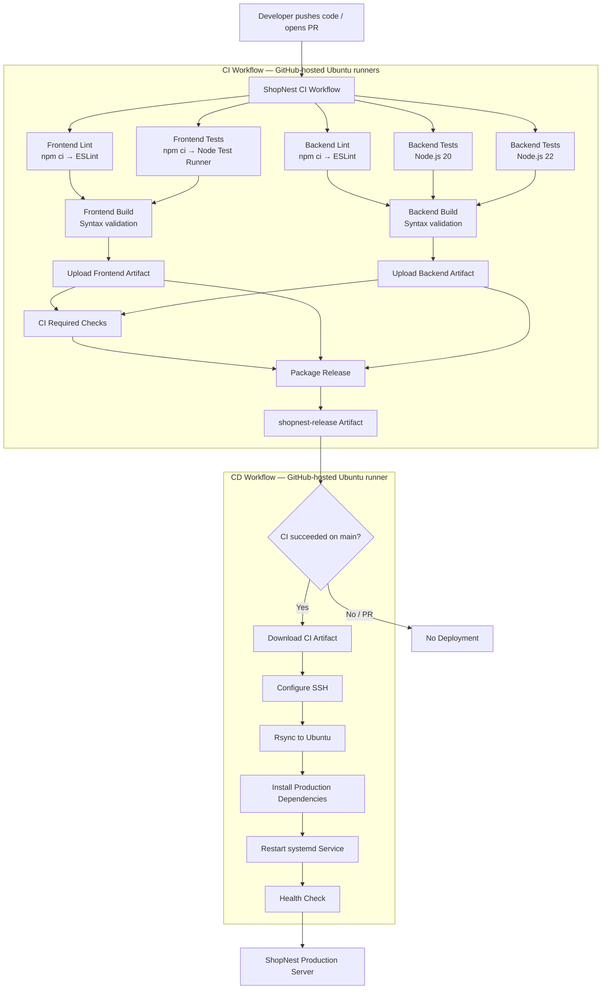

## Part A: CI/CD Concepts

# CI/CD at ShopNest: Overview for Management

## What CI, Continuous Delivery and Continuous Deployment are

**Continuous Integration (CI)** means every code change is merged into a shared branch often, and each merge automatically triggers a build and a set of tests. The goal is to catch broken code within minutes of it being written, not days later.

**Continuous Delivery (CD)** extends CI. Every change that passes the automated checks is built, packaged and deployed to a staging environment, so it is always in a releasable state. A person still approves the final push to production.

**Continuous Deployment (CD)** goes one step further and removes that manual approval. Every change that passes all automated checks goes live to customers automatically.

|  | CI | Continuous Delivery | Continuous Deployment |
| --- | --- | --- | --- |
| Automatic build and tests | Yes | Yes | Yes |
| Automatic release to staging | No | Yes | Yes |
| Production release | Manual | Manual approval | Fully automatic |
| Main risk addressed | Broken code merged | Unreliable releases | Slow release cycle |

## How the pipeline fixes each incident

Each incident below is paired with the pipeline stage that stops it and a concrete example. These incidents are illustrative placeholders; replace them with the three from the ShopNest scenario.

| Incident | Root cause | Pipeline stage that fixes it | Example in practice |
| --- | --- | --- | --- |
| 1. A code change breaks checkout for customers | Untested code was merged and released | **CI:** every commit triggers an automated build and test run, and a failing test blocks the merge | A developer changes the discount logic. The test "cart total with a 10% coupon" fails within minutes, so the change never reaches the main branch |
| 2. It worked on a developer's machine but failed in production | Manual deployments and differences between environments | **Build once, deploy everywhere:** one versioned artifact is deployed to staging, smoke-tested, then promoted unchanged to production, with settings kept outside the code | A missing database setting makes the staging smoke test fail. It is fixed before customers ever see it |
| 3. A bad release took hours to undo | Manual release steps and no quick way back | **Approval gate and rollback:** releases run through the same automated pipeline, and the previous version can be redeployed in one step | A payment bug is found after release. The team redeploys the last good version from the pipeline in minutes instead of rushing a manual hotfix |

## Which approach we chose and why

We chose **Continuous Delivery**.

ShopNest is an online store, so a faulty release can cost sales directly (broken checkout, wrong prices). Continuous Delivery gives us most of the speed benefit: every change is built, tested and staged automatically, so a release is a single click rather than a risky manual procedure. It also keeps a human decision before production, so releases can avoid peak trading periods and a person can check anything the tests can't catch.

We did not choose plain CI because it still leaves release as a manual, error-prone process. We did not choose Continuous Deployment because it depends on a very mature automated test suite and monitoring setup. It can be a future step once ShopNest has that confidence.


## Part B: Continuous Integration Pipeline

# ShopNest — Product Management & Inventory System

Express.js + MySQL product catalogue with a plain JavaScript frontend. MySQL runs directly on Ubuntu; 

## Local setup

```bash
npm install

# Edit .env with your MySQL connection values
npm run db:setup
npm run db:seed
npm run dev
```

Open `http://localhost:3000`.

## Database

The database is named `shopnest_db`. Create it and a restricted application account in MySQL:

```sql
CREATE DATABASE shopnest_db CHARACTER SET utf8mb4 COLLATE utf8mb4_unicode_ci;
CREATE USER 'root'@'localhost' IDENTIFIED BY 'YOUR_STRONG_PASSWORD';
GRANT SELECT, INSERT, UPDATE, DELETE ON shopnest_db.* TO 'shopnest_user'@'localhost';
FLUSH PRIVILEGES;
```

Configure `.env`. Import `database/schema.sql` and `database/seed.sql` if you prefer manual setup. The database setup script may require an administrative account because schema creation is not granted to the restricted runtime user.

## API

- `GET /health`
- `GET /api/products`
- `GET /api/products?search=mouse`
- `GET /api/products?category=Accessories`
- `GET /api/products/:id`

## CI checks

```bash
npm run lint:frontend
npm run test:frontend
npm run build:frontend
npm run lint:backend
npm run test:backend
npm run build:backend
```

Frontend tests use JSDOM to execute `public/app.js` and check product loading, search, category filtering, and API errors. Backend tests use Supertest against the real Express app, routes, and controllers, with a stubbed database adapter so GitHub Actions does not require a live MySQL service.

## GitHub Actions

`.github/workflows/ci-cd.yml` runs independent Frontend CI and Backend CI jobs on pushes and pull requests targeting `main`. Deployment runs only after both jobs pass and only on a push to `main`.

For deployment, configure these repository Actions secrets:

- `SERVER_HOST`: Ubuntu server IP or DNS name
- `SERVER_USER`: deployment account
- `SERVER_SSH_KEY`: private key matching the server user's `authorized_keys`
- `SERVER_PORT`: optional SSH port (defaults to 22)


The workflow syncs the application to `/var/www/shopnest`, preserves the server-side `.env`, installs production dependencies, restarts `shopnest.service`, and checks `/health`. The server must already have Node.js, npm, rsync, MySQL, the production `.env`, and the systemd service configured. Give the deploy user only the required directory and service permissions.

## Branch Protection – Block Merging When CI Fails

ShopNest uses GitHub Branch Protection Rules to prevent pull requests from being merged into the `main` branch unless all required Continuous Integration (CI) checks pass.


## GitHub Configuration For Branch Protection
1. Open your GitHub repository.
2. Navigate to Settings.
3. Open Rules → Rulesets or Branches.
4. Create a branch protection rule targeting main.
5. Enable Require a pull request before merging.
6. Enable Require status checks to pass before merging.
7. Select these required status checks:
   - Frontend CI
   - Backend CI
8. Enable Require branches to be up to date before merging.
9. Save the configuration.


## Expected Behavior

**Important:** Run the GitHub Actions workflow at least once before selecting the required status checks. GitHub needs to discover the check names first.

### Expected Branch Protection Behavior

| Frontend CI | Backend CI | Pull Request |
|---|---|---|
| Passed | Passed | Merge Allowed |
| Passed | Failed | Merge Blocked |
| Failed | Passed | Merge Blocked |
| Failed | Failed | Merge Blocked |
| Running | Passed | Merge Blocked |

### CI Failure Example

If a developer pushes code containing an ESLint error or a failing automated test:

1. GitHub Actions automatically starts the CI pipeline.
2. The Frontend CI or Backend CI job fails.
3. GitHub marks the required status check as failed.
4. The pull request cannot be merged while the required check is failing.

The developer must fix the issue, push the updated code, and wait for the CI checks to pass.

### Successful CI Example

When both jobs pass:

- Frontend CI: Success
- Backend CI: Success
- All other required branch rules: Satisfied

GitHub allows the pull request to be merged.

### Why Branch Protection Is Important

- Prevents broken code from reaching production.
- Ensures frontend and backend tests pass before merging.
- Enforces code quality through ESLint.
- Reduces deployment failures.
- Maintains a stable `main` branch.
- Encourages a pull-request-based development workflow.

**Note:** Repository administrators may have bypass permissions depending on the ruleset configuration. Disable bypass permissions if the protection must apply to administrators too.

**ShopNest Policy:** No code should be merged into the `main` branch unless all required CI checks pass.


## Part C: GitHub Actions Workflow Architecture
## After Understand Part C requirement remove ci-cd.yml file and separate CI CD Pipeline
ShopNest uses two separate GitHub Actions workflows:

- **CI:** `.github/workflows/ci.yml`
- **CD:** `.github/workflows/cd.yml`

### Workflow Architecture Diagram



### CI Job Execution Details

| Job | Runner | Main steps |
|---|---|---|
| Frontend Lint | ubuntu-latest | Checkout, Node 20, npm ci, ESLint |
| Frontend Tests | ubuntu-latest | Checkout, Node 20, npm ci, tests |
| Backend Lint | ubuntu-latest | Checkout, Node 20, npm ci, ESLint |
| Backend Tests | ubuntu-latest | Matrix: Node 20 and 22, npm ci, tests |
| Frontend Build | ubuntu-latest | Install, syntax validation, upload artifact |
| Backend Build | ubuntu-latest | Install, syntax validation, upload artifact |
| CI Required Checks | ubuntu-latest | Wait for all validation and build jobs |
| Package Release | ubuntu-latest | Download both artifacts and upload release |

### CD Job Execution Details

| Step | Action |
|---|---|
| Download artifact | Retrieve successful CI release |
| Configure SSH | Load deployment private key |
| Transfer files | rsync to `/var/www/shopnest` |
| Install | `npm ci --omit=dev` |
| Restart | `sudo systemctl restart shopnest` |
| Verify | Check service and `/health` endpoint |

### Build Artifact Transfer

CI produces three artifacts during its execution:

1. `shopnest-frontend`
2. `shopnest-backend`
3. `shopnest-release`

The package job combines the frontend and backend outputs into the release artifact.

CD downloads `shopnest-release` from the successful CI workflow run.

### Runtime Compatibility Testing

Backend tests use a GitHub Actions matrix strategy:

```yaml
strategy:
  fail-fast: false
  matrix:
    node-version: [20, 22]
```

This allows the backend test suite to run independently on Node.js 20 and Node.js 22.

### Branch Protection

The `main` branch requires the following status check:

- `CI Required Checks`

This gate depends on frontend lint, frontend tests, backend lint, backend tests on both Node.js versions, and both build jobs.

A pull request cannot be merged until the required check succeeds.

# ShopNest — Part D: Secrets and Configuration Management

## 1. Objective

 Part D requirements:

- No credential, key, password, or server address may be committed to the repository or remain exposed in Git history.
- Sensitive values must be stored and used securely.
- Staging and production configuration must be kept separate.
- Production deployments must require manual approval.
- The README must list every secret and variable by name and purpose, without revealing values.

## 2. Configuration management architecture

ShopNest uses:

- **GitHub Actions Secrets** for confidential values required by deployment workflows.
- **GitHub Actions Variables** for non-sensitive deployment settings.
- **GitHub Environments** to separate staging and production settings.
- **Server-side `.env` files** for application runtime configuration.
- **Git ignore rules** to prevent local environment files and private keys from being committed.

The staging and production environments must have separate credentials, server configuration, and database configuration.

## 3. Repository security

Add the following rules to the repository's `.gitignore`:

```gitignore
# Environment files
.env
.env.*
!.env.example

# Private keys and certificates
*.pem
*.key
id_rsa
id_ed25519

# Dependencies and generated files
node_modules/
coverage/
```

The committed `.env.example` file must contain placeholder values only. For example:

```env
NODE_ENV=development
PORT=3000

DB_HOST=localhost
DB_PORT=3306
DB_NAME=shopnest_db
DB_USER=your_database_user
DB_PASSWORD=your_database_password
```

Never put real passwords, private SSH keys, server IP addresses, or production connection strings in `.env.example`, workflow files, source code, documentation, or commit messages.

### If a secret was committed previously

`.gitignore` does not remove files already tracked by Git and does not erase old commits. If a credential was exposed:

1. Revoke or rotate the exposed credential immediately.
2. Remove the sensitive value from the current repository files.
3. Review the repository history for other exposed values.
4. If required, rewrite Git history using a suitable history-cleaning tool such as `git-filter-repo`.
5. Coordinate the history rewrite with other contributors and require fresh clones where appropriate.

Treat an exposed credential as compromised even after removing it from the latest commit.

## 4. Create GitHub Environments

In the GitHub repository:

1. Open **Settings**.
2. Select **Environments**.
3. Create an environment named `staging`.
4. Create another environment named `production`.

### Staging environment

- Stores staging-specific deployment secrets and variables.
- Deploys to the staging server and staging database.
- Can deploy automatically after successful CI, according to the deployment workflow.

### Production environment

- Stores production-specific deployment secrets and variables.
- Deploys to the production server and production database.
- Uses environment protection rules to require manual approval.

Use the same secret and variable names in both environments where practical, but configure different values in each environment. This allows a workflow to reference `secrets.SERVER_HOST` without hardcoding which server it should use.

## 5. GitHub Environment Secrets

Configure these secrets separately under **Settings → Environments → staging** and **Settings → Environments → production**.

| Secret name | Purpose |
|---|---|
| `SERVER_HOST` | IP address or hostname of the environment's deployment server |
| `SERVER_USER` | SSH username used by GitHub Actions to connect to the server |
| `SERVER_SSH_KEY` | Private SSH key used for deployment authentication |
| `SERVER_KNOWN_HOSTS` | Verified SSH host-key entry used to authenticate the server |
| `DB_PASSWORD` | Database password only if a GitHub Actions workflow genuinely needs it |

Do not put secret values in this document.

**Database password guidance:** If the ShopNest application reads its database password from a server-side `.env` file, keep the password on the server. Do not create a GitHub secret for it unless an automated workflow actually needs to connect to the database.

## 6. GitHub Environment Variables

Configure these non-sensitive variables separately for staging and production.

| Variable name | Purpose |
|---|---|
| `SERVER_PORT` | SSH port used to connect to the deployment server |
| `DEPLOY_PATH` | Directory where the ShopNest release is deployed |
| `SERVICE_NAME` | systemd service name used to manage the application |
| `APP_PORT` | Port on which the ShopNest backend listens |

Example purposes, not secret values:

- Staging deployment path: the staging application's directory.
- Production deployment path: the production application's directory.
- Staging service name: the staging systemd service.
- Production service name: the production systemd service.

## 7. Keep runtime configuration separate

The ShopNest application requires runtime configuration such as:

- `NODE_ENV`
- `PORT`
- `DB_HOST`
- `DB_PORT`
- `DB_NAME`
- `DB_USER`
- `DB_PASSWORD`

Keep separate runtime `.env` files on the appropriate servers. For example:

- Staging: the `.env` file stored in the staging application's protected directory.
- Production: the `.env` file stored in the production application's protected directory.

The real values must be entered directly on the relevant server or supplied through an approved secure configuration mechanism. Do not commit either file.

For a single-server production setup, a protected location such as `/etc/shopnest/shopnest.env` can be used. The systemd service can load it with `EnvironmentFile=`.

Restrict access to runtime environment files. For example:

```bash
sudo chown shopnest:shopnest /etc/shopnest/shopnest.env
sudo chmod 600 /etc/shopnest/shopnest.env
```

Use the actual service account and path configured on the server.

## 8. Protect `.env` during deployment

Deployment synchronization must not overwrite or delete the server's runtime environment file.

For example, an `rsync` deployment should exclude `.env`:

```bash
rsync -avz --delete \
  --exclude='.env' \
  ./bundle/ \
  "$SERVER_USER@$SERVER_HOST:$DEPLOY_PATH/"
```

If the deployment uses versioned release directories, keep the runtime environment file outside those release directories and configure systemd to load it from the protected location.

## 9. Production manual approval

In GitHub:

1. Open **Settings → Environments → production**.
2. Configure **Required reviewers**.
3. Add the authorized person or team.
4. Enable prevention of self-review if available.
5. Restrict deployment branches to `main` where supported.
6. Save the environment protection rules.

The production deployment job in the workflow must reference the environment:

```yaml
jobs:
  deploy-production:
    name: Deploy to Production
    environment: production
    runs-on: ubuntu-latest
    steps:
      # Production deployment steps
```

When the workflow reaches this job, GitHub pauses it until an authorized reviewer approves the deployment, subject to the repository's plan and environment-protection feature availability.

## 10. Use secrets and variables in GitHub Actions

Reference confidential values through the `secrets` context:

```yaml
env:
  SERVER_HOST: ${{ secrets.SERVER_HOST }}
  SERVER_USER: ${{ secrets.SERVER_USER }}
  SERVER_SSH_KEY: ${{ secrets.SERVER_SSH_KEY }}
  
```

Reference non-sensitive settings through the `vars` context:

```yaml
env:
  SERVER_PORT: ${{ vars.SERVER_PORT }}
  DEPLOY_PATH: ${{ vars.DEPLOY_PATH }}
  SERVICE_NAME: ${{ vars.SERVICE_NAME }}
  APP_PORT: ${{ vars.APP_PORT }}
```

Do not print secret values to workflow logs. Avoid enabling shell tracing (`set -x`) in steps that handle credentials. Use least-privilege permissions for deployment accounts and GitHub workflow tokens.

## 11. Secret and variable inventory


### Secrets

| Name | Purpose |
|---|---|
| `SERVER_HOST` | Environment-specific deployment server address |
| `SERVER_USER` | SSH deployment username |
| `SERVER_SSH_KEY` | SSH private key for deployment |
| `DB_PASSWORD` | Database password only if a workflow needs it |

### Variables

| Name | Purpose |
|---|---|
| `SERVER_PORT` | SSH port |
| `DEPLOY_PATH` | Deployment directory |
| `SERVICE_NAME` | systemd service name |
| `APP_PORT` | Backend application port |

### Runtime environment configuration

| Name | Purpose |
|---|---|
| `NODE_ENV` | Identifies the application environment |
| `PORT` | Backend listening port |
| `DB_HOST` | Database hostname or address |
| `DB_PORT` | Database port |
| `DB_NAME` | Database name |
| `DB_USER` | Database application username |
| `DB_PASSWORD` | Database application password |

The runtime configuration values are maintained in the server-side environment file. They are not all GitHub Actions secrets or variables.

## Part E: Automated Deployment to EC2

## 1. Part E requirements

The deployment process should:

1. Start after the ShopNest CI workflow completes successfully for a push to `main`.
2. Download the release artifact produced by that exact CI run.
3. Connect to the Ubuntu EC2 instance using SSH.
4. Upload the application files to the server.
5. Install production dependencies.
6. Restart the ShopNest application service.
7. Verify that the application is running and responding.
8. Record the Git commit SHA deployed to the server.
9. Keep the database private and keep runtime secrets on the server.

## 2. Deployment architecture

For the assignment's single-EC2 deployment, the application can be arranged as three logical tiers on one Ubuntu server:

```text
                    Internet
                       |
                 HTTPS / HTTP
                       |
                 AWS Security Group
                       |
                  Nginx :80/:443
                  /             \
          Frontend files       /api requests
          /var/www/.../public       |
                               Express API
                                127.0.0.1:3000
                                      |
                                   MySQL
                                127.0.0.1:3306
```

GitHub Actions deploys the application to EC2:

```text
Developer pushes to main
          |
          v
    GitHub CI workflow
          |
    CI checks succeed?
          |
          v
  Package release artifact
          |
          v
    GitHub CD workflow
          |
       SSH / rsync
          |
          v
       Ubuntu EC2
          |
   Install dependencies
          |
   Restart systemd service
          |
     Health check
          |
  Record deployed commit SHA
```

**Important:** This is a logical three-tier layout, not three physically separate servers.

## 3. AWS EC2 and network configuration

### 3.1 Security Group

Recommended inbound rules for a basic deployment:


### 3.2 Install server packages

Connect to EC2:

```bash
ssh -i your-key.pem ubuntu@EC2_PUBLIC_IP
```

Update Ubuntu:

```bash
sudo apt update
sudo apt upgrade -y
```

Install required packages:

```bash
sudo apt install -y nginx mysql-server git rsync curl
```

Install a supported Node.js LTS release using your chosen trusted installation method, then verify:

```bash
node --version
npm --version
nginx -v
mysql --version
```
## 4. MySQL configuration

The database should not be publicly reachable.

Check MySQL:

```bash
sudo systemctl status mysql
```

Open the MySQL shell:

```bash
sudo mysql
```

Example database and application user setup:

```sql
CREATE DATABASE shopnest_db;

CREATE USER 'shopnest_user'@'localhost'
IDENTIFIED BY 'REPLACE_WITH_A_STRONG_UNIQUE_PASSWORD';

GRANT SELECT, INSERT, UPDATE, DELETE
ON shopnest_db.*
TO 'shopnest_user'@'localhost';

FLUSH PRIVILEGES;
EXIT;
```
Check the MySQL bind address:

```bash
sudo ss -tlnp | grep 3306
```

For a same-server database, configure MySQL to listen on loopback (`127.0.0.1`) and restart it:

```bash
sudo systemctl restart mysql

## 5. Application configuration on EC2

Keep production environment variables outside the Git repository and outside the uploaded release.

Create a protected configuration directory:

```bash
sudo mkdir -p /etc/shopnest
sudo chown root:root /etc/shopnest
sudo chmod 750 /etc/shopnest
```

Create the production environment file:

```bash
sudo nano /etc/shopnest/shopnest.env
```
Protect the file:

```bash
sudo chown root:root /etc/shopnest/shopnest.env
sudo chmod 600 /etc/shopnest/shopnest.env
```
## 6. Create the ShopNest systemd service

Create the service file:

```bash
sudo nano /etc/systemd/system/shopnest.service
```

Example service configuration:

```ini
[Unit]
Description=ShopNest Product Management Application
After=network.target mysql.service
Wants=mysql.service

[Service]
Type=simple
User=ubuntu
WorkingDirectory=/var/www/shopnest
EnvironmentFile=/etc/shopnest/shopnest.env
ExecStart=/usr/bin/node /var/www/shopnest/server.js
Restart=always
RestartSec=5

[Install]
WantedBy=multi-user.target
```

Check the actual Node.js path before using it:

```bash
which node
```

If it is not `/usr/bin/node`, update `ExecStart` to the path returned by `which node`.

Create the deployment directory and give the deployment user ownership:

```bash
sudo mkdir -p /var/www/shopnest
sudo chown -R ubuntu:ubuntu /var/www/shopnest
```

Load and enable the service:

```bash
sudo systemctl daemon-reload
sudo systemctl enable shopnest
```

The first start will succeed only after the application files have been deployed:

```bash
sudo systemctl start shopnest
sudo systemctl status shopnest
```

Useful troubleshooting commands:

```bash
sudo journalctl -u shopnest -n 100 --no-pager
sudo journalctl -u shopnest -f
sudo systemctl restart shopnest
sudo systemctl is-active shopnest

## 7. Nginx configuration

Nginx is the public web server and reverse proxy. It can serve the frontend and forward API requests to Express.

Create a site configuration:

```bash
sudo nano /etc/nginx/sites-available/shopnest
```

Example:

```nginx
server {
    listen 80;
    server_name YOUR_DOMAIN_OR_PUBLIC_IP;

    root /var/www/shopnest/public;
    index index.html;

    location / {
        try_files $uri $uri/ /index.html;
    }

    location /api/ {
        proxy_pass http://127.0.0.1:3000;
        proxy_http_version 1.1;
        proxy_set_header Host $host;
        proxy_set_header X-Real-IP $remote_addr;
        proxy_set_header X-Forwarded-For $proxy_add_x_forwarded_for;
        proxy_set_header X-Forwarded-Proto $scheme;
    }

    location /health {
        proxy_pass http://127.0.0.1:3000;
        proxy_set_header Host $host;
    }
}
```

The `proxy_pass` form above preserves the incoming URI path. Confirm that the Express API routes expect paths such as `/api/products`. If the Express application expects `/products` instead, adjust the Nginx URI handling accordingly.

Enable the site:

```bash
sudo ln -s /etc/nginx/sites-available/shopnest /etc/nginx/sites-enabled/shopnest
sudo nginx -t
sudo systemctl reload nginx

## 12. Common deployment errors and troubleshooting

### 12.1 `Permission denied (publickey)`

Check:

- `SERVER_USER` matches the EC2 login user, for example `ubuntu`.
- `SERVER_SSH_KEY` contains the complete private key, including its header and footer.
- The matching public key is in the correct user's `~/.ssh/authorized_keys`.
- `.ssh` permissions are `700` and `authorized_keys` permissions are `600`.
- EC2 Security Group permits SSH from the runner's network path.

## History 
      sudo apt update
      sudo apt update && sudo apt install -y nodejs npm
      npm install pm2@latest -g
      pm2 --version
      sudo npm install pm2@latest -g
      sudo apt install nginx
      clear
      sudo apt install mysql-server -y
      sudo systemctl enable mysql
      sudo systemctl start mysql
      sudo mysql
      sudo apt install -y nodejs rsync
      clear
      sudo chown -R "$USER":"$USER" /var/www
      cd /var/www
      git clone https://github.com/sumaya-shemo/ShopNest.git
      ls -la
      cd ShopNest
      nano .env
      npm i
      npm start
      whoami
      sudo systemctl restart ShopNest
      mysql -u shopnest_user -p shopnest_db
      sudo mysql
      which node
      sudo nano /etc/systemd/system/shopnest.service
      sudo systemctl daemon-reload
      clear
      sudo systemctl enable shopnest
      sudo systemctl start shopnest
      sudo systemctl status shopnest
      sudo systemd-analyze verify /etc/systemd/system/shopnest.service
      sudo cat -n /etc/systemd/system/shopnest.service
      sudo nano /etc/systemd/system/shopnest.service
      clear
      sudo journalctl -u shopnest.service -n 100 --no-pager
      sudo journalctl -u shopnest -n 40 --no-pager
      clear
      which node
      sudo journalctl -u shopnest -n 40 --no-pager
      sudo systemctl status shopnest --no-pager
      sudo systemctl status shopnest
      clear
      sudo systemctl status shopnest
      curl http://127.0.0.1:3000/health
      history


