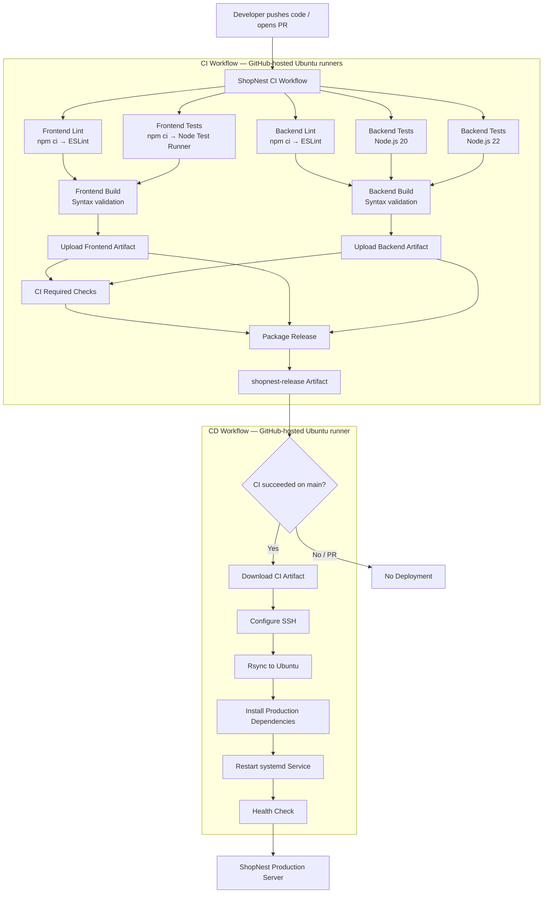

## Part A: CI/CD Concepts

# CI/CD at ShopNest: Overview for Management

## What CI, Continuous Delivery and Continuous Deployment are

**Continuous Integration (CI)** means every code change is merged into a shared branch often, and each merge automatically triggers a build and a set of tests. The goal is to catch broken code within minutes of it being written, not days later.

**Continuous Delivery (CD)** extends CI. Every change that passes the automated checks is built, packaged and deployed to a staging environment, so it is always in a releasable state. A person still approves the final push to production.

**Continuous Deployment (CD)** goes one step further and removes that manual approval. Every change that passes all automated checks goes live to customers automatically.

|  | CI | Continuous Delivery | Continuous Deployment |
| --- | --- | --- | --- |
| Automatic build and tests | Yes | Yes | Yes |
| Automatic release to staging | No | Yes | Yes |
| Production release | Manual | Manual approval | Fully automatic |
| Main risk addressed | Broken code merged | Unreliable releases | Slow release cycle |

## How the pipeline fixes each incident

Each incident below is paired with the pipeline stage that stops it and a concrete example. These incidents are illustrative placeholders; replace them with the three from the ShopNest scenario.

| Incident | Root cause | Pipeline stage that fixes it | Example in practice |
| --- | --- | --- | --- |
| 1. A code change breaks checkout for customers | Untested code was merged and released | **CI:** every commit triggers an automated build and test run, and a failing test blocks the merge | A developer changes the discount logic. The test "cart total with a 10% coupon" fails within minutes, so the change never reaches the main branch |
| 2. It worked on a developer's machine but failed in production | Manual deployments and differences between environments | **Build once, deploy everywhere:** one versioned artifact is deployed to staging, smoke-tested, then promoted unchanged to production, with settings kept outside the code | A missing database setting makes the staging smoke test fail. It is fixed before customers ever see it |
| 3. A bad release took hours to undo | Manual release steps and no quick way back | **Approval gate and rollback:** releases run through the same automated pipeline, and the previous version can be redeployed in one step | A payment bug is found after release. The team redeploys the last good version from the pipeline in minutes instead of rushing a manual hotfix |

## Which approach we chose and why

We chose **Continuous Delivery**.

ShopNest is an online store, so a faulty release can cost sales directly (broken checkout, wrong prices). Continuous Delivery gives us most of the speed benefit: every change is built, tested and staged automatically, so a release is a single click rather than a risky manual procedure. It also keeps a human decision before production, so releases can avoid peak trading periods and a person can check anything the tests can't catch.

We did not choose plain CI because it still leaves release as a manual, error-prone process. We did not choose Continuous Deployment because it depends on a very mature automated test suite and monitoring setup. It can be a future step once ShopNest has that confidence.


## Part B: Continuous Integration Pipeline

# ShopNest — Product Management & Inventory System

Express.js + MySQL product catalogue with a plain JavaScript frontend. MySQL runs directly on Ubuntu; 

## Local setup

```bash
npm install
cp .env.example .env
# Edit .env with your MySQL connection values
npm run db:setup
npm run db:seed
npm run dev
```

Open `http://localhost:3000`.

## Database

The database is named `shopnest_db`. Create it and a restricted application account in MySQL:

```sql
CREATE DATABASE shopnest_db CHARACTER SET utf8mb4 COLLATE utf8mb4_unicode_ci;
CREATE USER 'root'@'localhost' IDENTIFIED BY 'YOUR_STRONG_PASSWORD';
GRANT SELECT, INSERT, UPDATE, DELETE ON shopnest_db.* TO 'shopnest_user'@'localhost';
FLUSH PRIVILEGES;
```

Configure `.env`. Import `database/schema.sql` and `database/seed.sql` if you prefer manual setup. The database setup script may require an administrative account because schema creation is not granted to the restricted runtime user.

## API

- `GET /health`
- `GET /api/products`
- `GET /api/products?search=mouse`
- `GET /api/products?category=Accessories`
- `GET /api/products/:id`

## CI checks

```bash
npm run lint:frontend
npm run test:frontend
npm run build:frontend
npm run lint:backend
npm run test:backend
npm run build:backend
```

Frontend tests use JSDOM to execute `public/app.js` and check product loading, search, category filtering, and API errors. Backend tests use Supertest against the real Express app, routes, and controllers, with a stubbed database adapter so GitHub Actions does not require a live MySQL service.

## GitHub Actions

`.github/workflows/ci-cd.yml` runs independent Frontend CI and Backend CI jobs on pushes and pull requests targeting `main`. Deployment runs only after both jobs pass and only on a push to `main`.

For deployment, configure these repository Actions secrets:

- `SERVER_HOST`: Ubuntu server IP or DNS name
- `SERVER_USER`: deployment account
- `SERVER_SSH_KEY`: private key matching the server user's `authorized_keys`
- `SERVER_PORT`: optional SSH port (defaults to 22)


The workflow syncs the application to `/var/www/shopnest`, preserves the server-side `.env`, installs production dependencies, restarts `shopnest.service`, and checks `/health`. The server must already have Node.js, npm, rsync, MySQL, the production `.env`, and the systemd service configured. Give the deploy user only the required directory and service permissions.

## Branch Protection – Block Merging When CI Fails

ShopNest uses GitHub Branch Protection Rules to prevent pull requests from being merged into the `main` branch unless all required Continuous Integration (CI) checks pass.


## GitHub Configuration For Branch Protection
1. Open your GitHub repository.
2. Navigate to Settings.
3. Open Rules → Rulesets or Branches.
4. Create a branch protection rule targeting main.
5. Enable Require a pull request before merging.
6. Enable Require status checks to pass before merging.
7. Select these required status checks:
   - Frontend CI
   - Backend CI
8. Enable Require branches to be up to date before merging.
9. Save the configuration.


## Expected Behavior

**Important:** Run the GitHub Actions workflow at least once before selecting the required status checks. GitHub needs to discover the check names first.

### Expected Branch Protection Behavior

| Frontend CI | Backend CI | Pull Request |
|---|---|---|
| Passed | Passed | Merge Allowed |
| Passed | Failed | Merge Blocked |
| Failed | Passed | Merge Blocked |
| Failed | Failed | Merge Blocked |
| Running | Passed | Merge Blocked |

### CI Failure Example

If a developer pushes code containing an ESLint error or a failing automated test:

1. GitHub Actions automatically starts the CI pipeline.
2. The Frontend CI or Backend CI job fails.
3. GitHub marks the required status check as failed.
4. The pull request cannot be merged while the required check is failing.

The developer must fix the issue, push the updated code, and wait for the CI checks to pass.

### Successful CI Example

When both jobs pass:

- Frontend CI: Success
- Backend CI: Success
- All other required branch rules: Satisfied

GitHub allows the pull request to be merged.

### Why Branch Protection Is Important

- Prevents broken code from reaching production.
- Ensures frontend and backend tests pass before merging.
- Enforces code quality through ESLint.
- Reduces deployment failures.
- Maintains a stable `main` branch.
- Encourages a pull-request-based development workflow.

**Note:** Repository administrators may have bypass permissions depending on the ruleset configuration. Disable bypass permissions if the protection must apply to administrators too.

**ShopNest Policy:** No code should be merged into the `main` branch unless all required CI checks pass.


## Part C: GitHub Actions Workflow Architecture

ShopNest uses two separate GitHub Actions workflows:

- **CI:** `.github/workflows/ci.yml`
- **CD:** `.github/workflows/cd.yml`

### Workflow Architecture Diagram



### CI Job Execution Details

| Job | Runner | Main steps |
|---|---|---|
| Frontend Lint | ubuntu-latest | Checkout, Node 20, npm ci, ESLint |
| Frontend Tests | ubuntu-latest | Checkout, Node 20, npm ci, tests |
| Backend Lint | ubuntu-latest | Checkout, Node 20, npm ci, ESLint |
| Backend Tests | ubuntu-latest | Matrix: Node 20 and 22, npm ci, tests |
| Frontend Build | ubuntu-latest | Install, syntax validation, upload artifact |
| Backend Build | ubuntu-latest | Install, syntax validation, upload artifact |
| CI Required Checks | ubuntu-latest | Wait for all validation and build jobs |
| Package Release | ubuntu-latest | Download both artifacts and upload release |

### CD Job Execution Details

| Step | Action |
|---|---|
| Download artifact | Retrieve successful CI release |
| Configure SSH | Load deployment private key |
| Transfer files | rsync to `/var/www/shopnest` |
| Install | `npm ci --omit=dev` |
| Restart | `sudo systemctl restart shopnest` |
| Verify | Check service and `/health` endpoint |

### Build Artifact Transfer

CI produces three artifacts during its execution:

1. `shopnest-frontend`
2. `shopnest-backend`
3. `shopnest-release`

The package job combines the frontend and backend outputs into the release artifact.

CD downloads `shopnest-release` from the successful CI workflow run.

### Runtime Compatibility Testing

Backend tests use a GitHub Actions matrix strategy:

```yaml
strategy:
  fail-fast: false
  matrix:
    node-version: [20, 22]
```

This allows the backend test suite to run independently on Node.js 20 and Node.js 22.

### Branch Protection

The `main` branch requires the following status check:

- `CI Required Checks`

This gate depends on frontend lint, frontend tests, backend lint, backend tests on both Node.js versions, and both build jobs.

A pull request cannot be merged until the required check succeeds.


